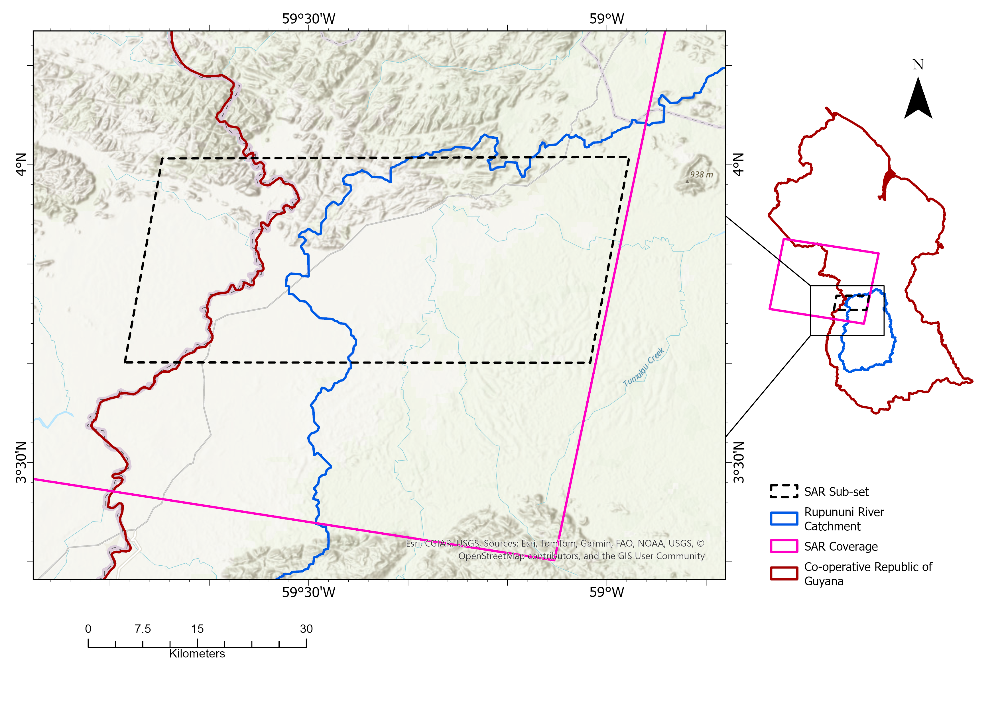
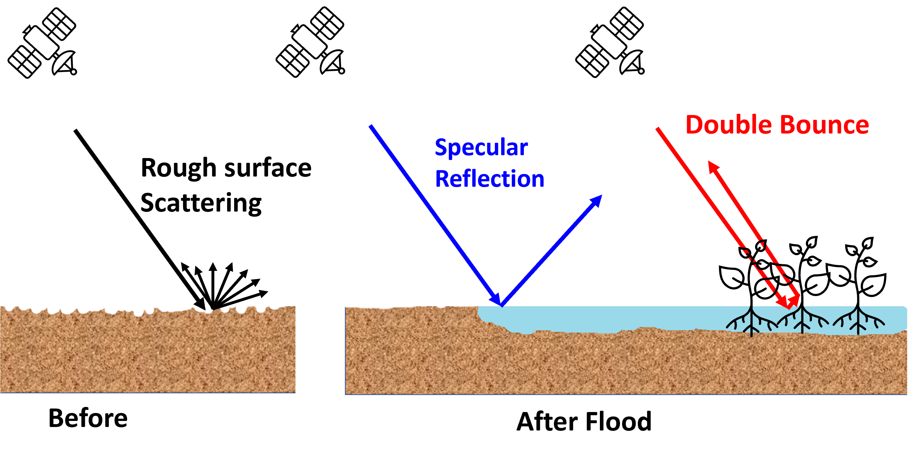
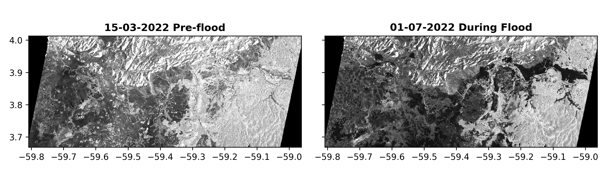
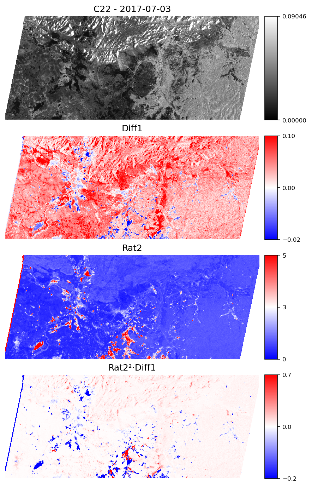

# Analytical Optimization of Polarimetric Change Detectors for Flood Mapping

Code accompanying the paper published in *IEEE Journal of Selected Topics in Applied Earth Observations and Remote Sensing (JSTARS)*.

[](https://ieeexplore.ieee.org/document/11717852)

## Publication

**Felix Kasiti Isundwa, Armando Marino, Andrea Berardi, C Isabella Bovolo, Peter Hunter, Claire Neil, and Thiago S. F. Silva** (2026).
*Analytical Optimization of Polarimetric Change Detectors for Mapping Open and Grassland Flooding Using Sentinel-1. Case of Rupununi, Guyana.*
IEEE Journal of Selected Topics in Applied Earth Observations and Remote Sensing (JSTARS).
[https://ieeexplore.ieee.org/document/11717852](https://ieeexplore.ieee.org/document/11717852)

## Overview

Quantifying flood inundation beneath vegetation is critical for understanding flood dynamics in complex wetland environments. This work proposes a generalization of polarimetric change-detection theory to derive new analytical optimization frameworks that combine sets of previously proposed detectors. The approach investigates additive signal changes to inform or be combined with multiplicative models for better characterization of both open-water and vegetation-covered flooding in the Rupununi wetland, Guyana.

**Study area**: Rupununi River catchment (tributary of the Essequibo River), southwestern Guyana
**Data**: 214 Sentinel-1 SLC images (VV-VH polarization) from 2016 to 2023
**Methods**: Polarimetric change detection with analytical optimization

**Key results**
- Four detector models evaluated with varying separability between open and grassland floods
- Best detector achieves robust separation of open-water flooding, grassland flooding, and non-flood areas
- Linear combinations and mixed (data-driven) models provide superior performance in complex wetland environments

## Figures

### Study area and SAR footprint

*Figure 1. Map of the study area with reference to the Satellite data footprint.*

### Scattering mechanisms

*Figure 2. Three scattering mechanisms: rough surface scattering, specular reflection, and double bounce scattering in short vegetation and bare ground before and after floods.*

### SAR backscatter visualization

*Figure 3. VH channel backscatter intensity showing preflood and postflood images during dry and rainy seasons.*

### Detector optimization and results

*Figure 4. Spatial representation of combination of Rat1 and DifH detector outputs showing flood/no-flood classification.*

> Note: Figures are reproduced from the paper. Check the IEEE copyright terms before publishing them publicly, or recreate them from your own code and data.

## Methodology

The analysis combines polarimetric SAR theory with optimization frameworks to develop robust flood detectors:

1. **Signal modeling**: Generalization of polarimetric change-detection theory using additive and multiplicative models
2. **Detector development**: Four detector models (monomial unity, monomial, linear, and mixed combinations)
3. **Optimization**: Analytical optimization using eigenvalue decomposition and parameter tuning
4. **Validation**: Accuracy assessment using optical data (PlanetScope) and ROC/AUC metrics
5. **Classification**: Separation of open-water floods, grassland floods, and non-flooded areas

## Jupyter Notebooks

The step-by-step analysis is split into two notebooks:

**1. [`notebooks/01_change_detection.ipynb`](notebooks/01_change_detection.ipynb)** — change detection
- Reading SNAP-exported ENVI covariance elements (`.hdr`/`.img`)
- Boxcar speckle filtering
- Computing the full detector bank (OPDiff, OPRatio, Model 1/3/4, Wishart, ...)
- Plotting every detector result (before thresholding), controlled by a dictionary

**2. [`notebooks/02_accuracy_assessment.ipynb`](notebooks/02_accuracy_assessment.ipynb)** — accuracy assessment
- Loads the saved detector outputs (`results/<name>_<date>.npy`)
- Thresholding and ROC/AUC assessment against reference masks
- Per-cover-class metrics (Grassland / open-water / combined) + AUC summary table

The same code is also available as standalone scripts:
[`change_detection.py`](change_detection.py) and
[`accuracy_assessment.py`](accuracy_assessment.py).

## Installation

```bash
git clone https://github.com/[your-username]/flood-mapping-sar.git
cd flood-mapping-sar
pip install -r requirements.txt
jupyter notebook notebooks/flood_detection_analysis.ipynb
```

## Repository Structure

```
.
├── README.md
├── LICENSE
├── requirements.txt
├── images/                        # figures from the paper
│   ├── study_area.png
│   ├── scattering_mechanisms.png
│   ├── sar_backscatter.png
│   └── detector_results.png
├── notebooks/
│   └── flood_detection_analysis.ipynb
└── data/                          # sample SAR data or download instructions
```

## Citation

```bibtex
@article{isundwa2026flood,
  author  = {Isundwa, Felix Kasiti and Marino, Armando and Berardi, Andrea and Bovolo, Isabella and Hunter, Peter and Neil, Claire and Silva, Thiago S. F.},
  title   = {Analytical Optimization of Polarimetric Change Detectors for Mapping Open and Grassland Flooding Using Sentinel-1. Case of Rupununi, Guyana},
  journal = {IEEE Journal of Selected Topics in Applied Earth Observations and Remote Sensing (JSTARS)},
  year    = {2026},
  doi     = {10.1109/JSTARS.2026.3739494}
}
```

## Related Work

This work builds on and extends polarimetric SAR change detection theory. See the paper for detailed references and related work on:
- Polarimetric SAR signal modeling and optimization
- Flood detection and monitoring with SAR
- Wetland inundation dynamics

## License

- **Code** (`.py`, `.ipynb`): [MIT License](LICENSE)
- **Documentation and figures created for this repository**: [CC BY 4.0](https://creativecommons.org/licenses/by/4.0/)
- The published article and any figures reproduced from it are © IEEE and are not covered by these licenses.

## Contact

Felix Kasiti Isundwa, University of Stirling  
[GitHub](https://github.com/kasitif)
